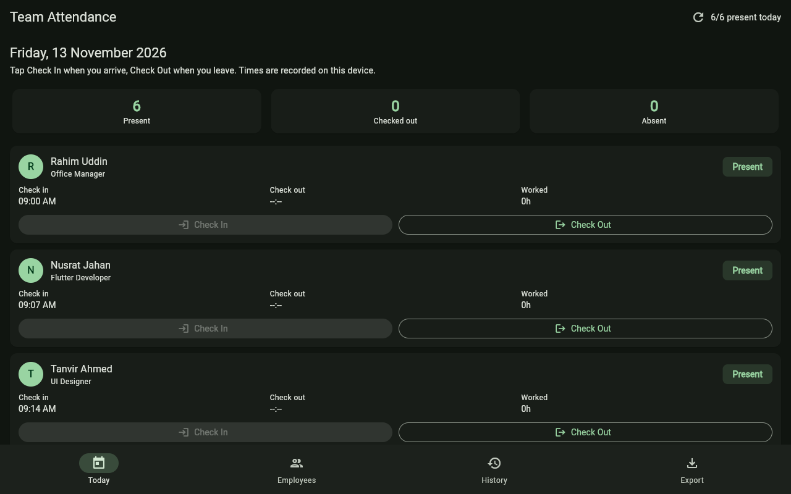
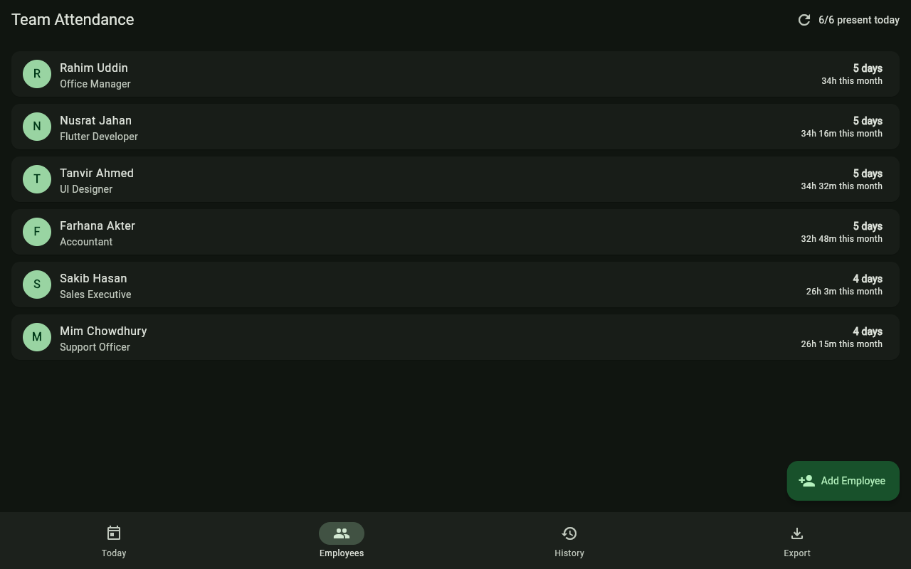
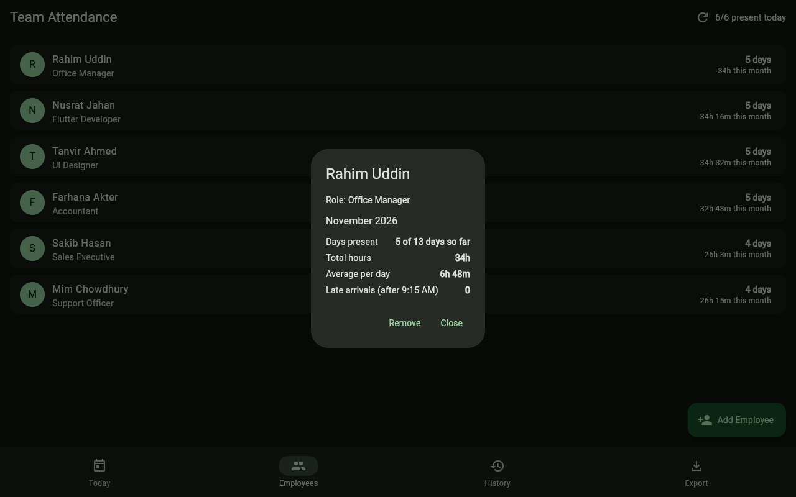
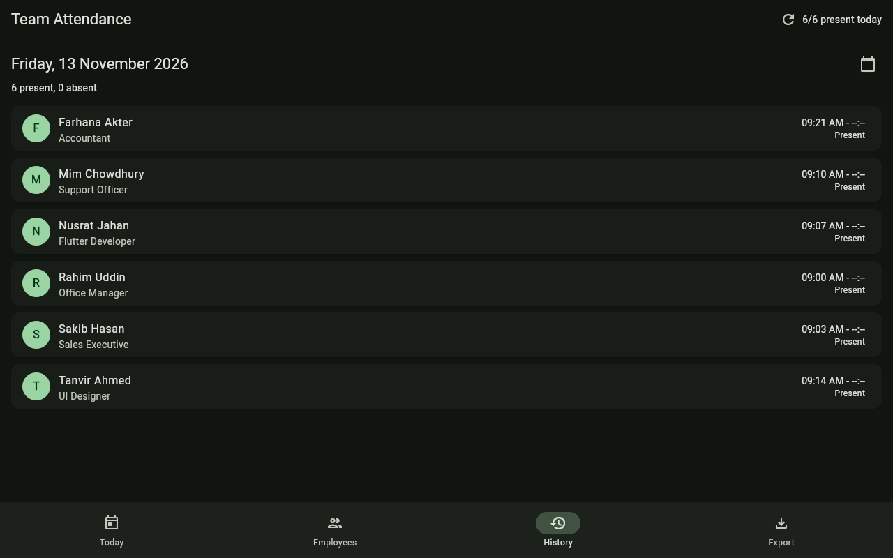

# Team Attendance

A staff attendance app for small teams. Employees check in when they arrive and check out when they leave. The app shows a today register, per employee monthly summaries, attendance history by date, and a CSV export.

Built with Flutter and Material 3, dark theme with a #39FF88 accent. Part of a one app per day reference build series by Partho Sarothi Paik. All code is original, written for this project.

Try it in your browser: https://codebypartho.github.io/team-attendance/

## Download the APK

Download the APK from the [v1.1.0 release](https://github.com/CodeByPartho/team-attendance/releases) on GitHub. Two files are attached: `team-attendance-v1.1.0.apk` (universal) and `team-attendance-v1.1.0-arm64.apk` (smaller, arm64 phones only).

## Screenshots






## Features

- Employee list: add employees with a name, role, phone, email, join date, department, hourly rate and employment type; edit any employee with the same form; archive instead of delete, so history is kept and the person leaves the today register
- Daily check in and check out with timestamps, one record per employee per day
- Break tracking: start and end a break from the Today tab; break minutes are subtracted from worked hours
- Today register: who is present, who checked out, who is absent, with live counts
- Monthly summary per employee: days present, days absent, attendance percentage, total, regular and overtime hours, average hours per day, late arrivals (against office start plus grace from Settings), and a monthly pay estimate
- Attendance history: pick any date and see that day's full register; tap a row to correct a wrong punch (check in, check out, break, reason: forgot, late, half day), flagged as edited
- Auto check out: anyone still checked in at the end of the day is checked out at office end time, flagged as auto
- Settings: working days, office start time, late grace minutes, standard hours per day, overtime rule (over standard hours a day, or over 48 hours a week), overtime multiplier, currency (default BDT), reminder times
- Reports tab: team monthly table (present, absent, leave, late, hours, attendance percent), hours bar chart, late days list, month navigation, team pay estimate total
- Salary and payroll estimate: regular hours at the hourly rate plus overtime hours at the rate times the multiplier (default 1.5), per employee pay slip card and team monthly total; labelled as an estimate, not a legal payslip; unpaid leave is 0 because leave is not tracked yet
- Real file exports: monthly team PDF and .xlsx (Summary and Detail sheets) written to a file and opened in the native share sheet, plus the CSV copy option with date and employee filters
- Backup and restore: export all employees, records and settings as one JSON file through the share sheet, import it back with validation and a confirm before overwrite
- Demo seed data: 6 employees with this week's attendance on first run, so the app is useful immediately
- Reset data: from the refresh button in the AppBar, clear all data to start with an empty team, or restore the 6 person demo team
- Local persistence with shared_preferences, data survives app restarts

## How it works

By default the app runs in local demo mode. All data is stored on the device as JSON in shared_preferences. There is no account, no server, and no data leaves the device.

A Supabase schema is included at `supabase/schema.sql` so the app can be wired to a real backend later. It defines `employees` and `attendance` tables, a monthly summary view, and starter row level security policies. The app does not connect to Supabase yet: that wiring is a deliberate next step, not a hidden feature. It was deliberately left out of v1.1.0 because the schema's starter policies let any signed in user read and write everything, so wiring it now would ship a security hole. It needs a project with per-user policies first. See "Wiring up Supabase" below.

## Wiring up Supabase

1. Create a project at supabase.com and run `supabase/schema.sql` in the SQL editor.
2. Add the `supabase_flutter` package and initialise it in `main.dart` with your project URL and anon key.
3. Replace the shared_preferences save and load in `lib/state/attendance_provider.dart` with Supabase queries against the `employees` and `attendance` tables. Keep the same method names (`checkIn`, `checkOut`, `monthlySummary`, `toCsv`) so the screens do not change.
4. Tighten the starter row level security policies to your own roles before going live. The included policies allow any signed in user to manage both tables, which is a starting point, not a production setup.

## Run it

```bash
flutter pub get
flutter run
```

For a web build:

```bash
flutter build web
```

## Tests

```bash
flutter test
```

Unit tests cover check in and check out rules, monthly day counts and hours, late arrival counting, the today register, CSV export, and data reset (clear all and restore demo), plus the v1.1.0 logic: record editing and auto check out, late calculation from settings, break subtraction and overtime math (per day and per week), payroll estimates, archive behaviour, report aggregation, export data builders, backup validation and import, and settings persistence. 55 tests in total.

## Tech

- Flutter, Material 3, dark theme
- State: provider
- Storage: shared_preferences (JSON)
- Dates: intl
- Charts: fl_chart
- File exports: pdf, printing, excel_community, share_plus, path_provider, file_picker
- Dependencies only: provider, intl, shared_preferences, fl_chart, pdf, printing, share_plus, path_provider, file_picker, excel_community, flutter_lints (dev)
